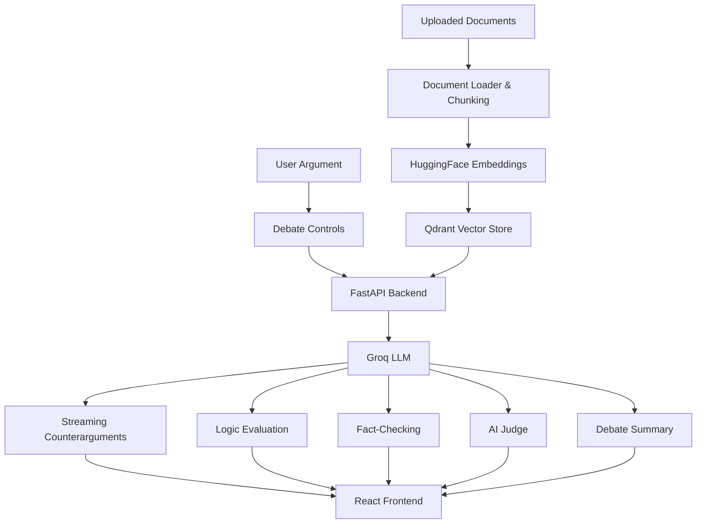

# Devil's Advocate – AI-Powered Debate & Argument Evaluation Platform

**Devil's Advocate** is an interactive AI-powered debate and critical-thinking platform designed to stress-test arguments, identify logical fallacies, evaluate reasoning, verify claims against uploaded reference documents, and adjudicate debate rounds.

Rather than simply agreeing with the user or generating generic responses, the platform acts as an intelligent sparring partner that challenges arguments across configurable stances, tones, and difficulty levels. It combines real-time streamed counterarguments, structured logic evaluation, document-grounded retrieval, and AI-powered debate judging.

---

## Problem Statement

When drafting pitches, essays, policy positions, technical arguments, or opinions, it is easy to overlook hidden assumptions, weak evidence, and logical fallacies, especially when working alone or relying on AI assistants that tend to be agreeable.

Common challenges include:

- Unchallenged premises and hidden assumptions.
- Logical fallacies such as false dichotomies, hasty generalizations, and circular reasoning.
- Claims unsupported by evidence or reference material.
- Difficulty objectively evaluating the strength of opposing arguments.

Devil's Advocate addresses these challenges by providing an interactive platform for argumentation, critical analysis, evidence-based verification, and structured debate evaluation.

---

## Objectives

- Generate targeted and constructive counterarguments based on configurable stance, tone, and difficulty.
- Analyze argument structure, core claims, strengths, weaknesses, and logical fallacies.
- Identify unsupported claims and reasoning gaps.
- Verify claims against uploaded PDF documents using semantic retrieval.
- Compare human and AI arguments through an AI-powered debate judge.
- Support interactive debate sessions with streaming responses, speech capabilities, session history, timers, and theme customization.

---

## Key Features

| Feature | Description |
|---|---|
| **Streaming Debate Engine** | Generates real-time counterarguments using streamed LLM responses. |
| **Configurable Debate Modes** | Customize stance, tone, and difficulty level. |
| **Logic Evaluation** | Analyzes arguments, scores reasoning, and identifies strengths and weaknesses. |
| **Fallacy Detection** | Highlights potential logical fallacies and reasoning gaps. |
| **Document-Based Fact-Checking** | Retrieves relevant context from uploaded documents to evaluate claims. |
| **AI Debate Judge** | Compares arguments and provides a verdict with supporting reasoning. |
| **Debate Summarization** | Generates summaries of recorded debate sessions. |
| **Voice Interaction** | Supports speech input and text-to-speech using browser speech APIs. |
| **Session Controls** | Includes debate timers, history, and light/dark themes. |
| **Document Retrieval** | Uses embeddings and vector search to retrieve relevant uploaded content. |

---

## System Architecture



### Architecture Overview

- **Frontend:** React-based interface for debate configuration, argument submission, streamed responses, evaluation results, and interactive controls.
- **Backend:** FastAPI handles API requests, LLM workflows, document processing, retrieval, and evaluation.
- **LLM Integration:** Groq provides streamed inference and AI-powered analysis.
- **Retrieval Pipeline:** Uploaded documents are processed, chunked, embedded, and indexed in Qdrant for semantic retrieval.
- **Evaluation Workflows:** Separate backend endpoints handle argument evaluation, fact-checking, judging, and summarization.

---

## How It Works

### 1. Streaming Counterargument Engine

The debate engine uses Groq chat completions with the `llama-3.3-70b-versatile` model to generate real-time counterarguments.

Counterarguments are tailored to the user's selected:

- **Stance:** The debate position or opposing perspective.
- **Tone:** The communication style.
- **Difficulty:** The depth and complexity of the response.

The engine aims to challenge the user's argument by:

- Targeting weak assumptions and unsupported reasoning.
- Identifying potential logical gaps.
- Presenting meaningful opposing perspectives.
- Suggesting ways to strengthen the argument.

The debate endpoint supports streamed responses and optionally incorporates retrieved document context.

### 2. Logic Evaluation

The logic evaluation workflow analyzes the submitted argument and returns structured feedback, including:

- Overall logic score.
- Core claim.
- Strengths.
- Weaknesses.
- Identified fallacies.
- Unsupported claims.

### 3. Document-Based Fact-Checking

The fact-checking workflow uses Retrieval-Augmented Generation (RAG) to evaluate claims against uploaded reference documents.

The pipeline:

1. Accepts uploaded documents.
2. Extracts and splits document content into chunks.
3. Generates embeddings using HuggingFace sentence transformers.
4. Stores embeddings in Qdrant.
5. Retrieves relevant chunks based on the submitted claim.
6. Uses retrieved context to generate a contextual fact-checking response.

### 4. AI Debate Judge

The AI judge evaluates the human argument and AI counterargument to determine which side presents the stronger case.

The evaluation provides:

- A comparative assessment.
- A debate winner.
- Reasoning behind the verdict.

### 5. Debate Summarization

The summary endpoint processes recorded debate history and generates a concise summary of the discussion when requested.

---

## Technology Stack

### Backend

| Technology | Purpose |
|---|---|
| Python | Backend programming language |
| FastAPI | API development and backend framework |
| Uvicorn | ASGI server |
| Groq SDK | LLM integration and streaming inference |
| Pydantic | Request validation and structured data handling |
| LangChain | Document processing and RAG pipeline orchestration |
| LangChain Text Splitters | Document chunking |
| LangChain HuggingFace | Embedding integration |
| LangChain Qdrant | Vector store integration |
| Qdrant | Vector database |
| Sentence Transformers | Semantic embeddings |
| `all-MiniLM-L6-v2` | Embedding model |

### Frontend

| Technology | Purpose |
|---|---|
| React 18 | Frontend application development |
| Vite | Development server and build tooling |
| Tailwind CSS | UI styling |
| Browser Speech APIs | Speech recognition and text-to-speech |
| CSS Print Styles | Print-friendly interface support |

### Deployment & Tooling

- Docker
- Node.js
- npm

---

## Project Structure

```text
Devil's Advocate/
├── backend/
│   ├── main.py
│   ├── models.py
│   ├── ai_services.py
│   ├── requirements.txt
│   ├── dockerfile
│   └── temp_uploads/
│
└── frontend/
    ├── index.html
    ├── package.json
    ├── vite.config.js
    ├── postcss.config.js
    └── src/
        ├── app.jsx
        └── index.css
```

---

## API Endpoints

| Method | Endpoint | Description |
|---|---|---|
| `POST` | `/api/upload` | Uploads documents, processes chunks, and indexes embeddings in Qdrant. |
| `POST` | `/api/debate` | Streams counterarguments using Server-Sent Events (SSE). |
| `POST` | `/api/evaluate` | Performs structured logic evaluation of an argument. |
| `POST` | `/api/factcheck` | Verifies claims against retrieved document context. |
| `POST` | `/api/judge` | Evaluates human and AI arguments and returns a verdict. |
| `POST` | `/api/summary` | Summarizes recorded debate history. |

---

## Installation & Setup

### Prerequisites

- Python
- Node.js and npm
- Groq API key
- Git

### 1. Clone the Repository

```bash
git clone https://github.com/YOUR_USERNAME/devils-advocate.git
cd devils-advocate
```

### 2. Backend Setup

Navigate to the backend directory:

```bash
cd backend
```

Create and activate a virtual environment:

```bash
python -m venv venv
```

**Windows:**

```bash
.\venv\Scripts\activate
```

**Linux/macOS:**

```bash
source venv/bin/activate
```

Install the dependencies:

```bash
pip install -r requirements.txt
```

Configure your Groq API key using an environment variable or a `.env` file:

```env
GROQ_API_KEY=your_groq_api_key_here
```

Start the backend server:

```bash
uvicorn main:app --reload
```

The backend will be available at:

```text
http://127.0.0.1:8000
```

FastAPI documentation:

```text
http://127.0.0.1:8000/docs
```

### 3. Frontend Setup

Open a separate terminal and navigate to the frontend directory:

```bash
cd frontend
```

Install dependencies:

```bash
npm install
```

Start the frontend development server:

```bash
npm run dev
```

The frontend will be available at:

```text
http://localhost:5173
```

---

## Docker Deployment (Backend)

Build the backend Docker image:

```bash
docker build -t devils-advocate-backend ./backend
```

Run the container:

```bash
docker run -p 8000:8000 --env-file ./backend/.env devils-advocate-backend
```

---

## Safety, Privacy & Limitations

- **Ephemeral Document Processing:** Uploaded files are processed using temporary storage, which is cleaned up after ingestion.
- **In-Memory Vector Store:** Qdrant is configured using in-memory storage (`:memory:`), making the current implementation suitable for prototyping rather than persistent production storage.
- **LLM Output Variability:** Logic scores, fallacy labels, fact-checking responses, and judge verdicts are AI-generated and may be inaccurate.
- **Document-Grounded Verification Limitations:** Fact-checking depends on the relevance, quality, and completeness of uploaded reference material.
- **Browser Compatibility:** Speech recognition and speech synthesis depend on browser and environment support.
- **Dependency Compatibility:** Python, LangChain, Pydantic, Qdrant, and related packages require compatible versions.

---

## Future Improvements

- Persistent vector storage and multi-document session management.
- Stronger structured-output validation and schema enforcement.
- Automated backend testing using pytest.
- Frontend component and integration testing.
- Debate transcript, evaluation score, and verdict export.
- Unified frontend and backend deployment.
- Enhanced evidence attribution and citation support.
- Improved evaluation consistency and benchmarking.

---

## Disclaimer

Devil's Advocate is an educational and experimental application designed to assist with critical thinking and argument evaluation.

AI-generated critiques, logical fallacy classifications, fact-checks, scores, and debate verdicts are not guaranteed to be accurate or objective. Users should independently verify important claims and supporting evidence.

---

## License

This project is intended for educational, demonstration, and personal development purposes.
